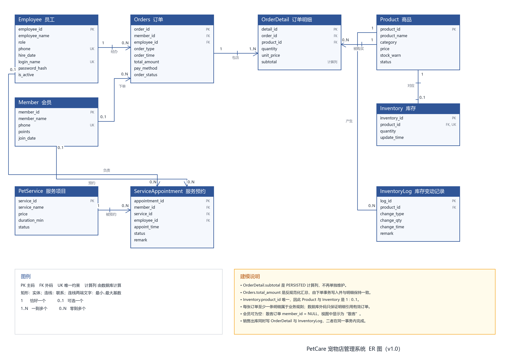

# 第5周 ER 模型、业务规则与 v0.1 问题清单

| 项目 | 内容 |
|---|---|
| 课程阶段 | 第5周：概念模型与业务规则 |
| 成员 | 成员A（数据侧） |
| 版本 | v1.0（2026-11-08） |
| 依据 | `sql/02_create_tables.sql`、`sql/07_constraint.sql`、`sql/06_view.sql`、`sql/migration.sql` |
| 对应实现 | `Pet_Shop-main` 现有 v1.0 数据库与 DAO 层 |

## 0. 交付物与验收对照

| 任务要求 | 本文件位置 | 可复现文件 |
|---|---|---|
| ER 图，含实体、属性、标识符、联系、基数、参与约束、图例 | 第2、3、4节，图1 | `docs/er/petcare_er.svg`、`docs/er/petcare_er.png` |
| ER 图可编辑源文件 | 第1.2节 | `docs/er/petcare_er.mmd`、`docs/er/render_er.py` |
| 业务规则与落库映射，含最小/最大基数、条件、表/外码、强制方式 | 第4节 | `sql/02_create_tables.sql`、`sql/07_constraint.sql`、`sql/migration.sql` |
| v0.1 问题清单，含业务证据、影响、改进方向 | 第5节 | `docs/w6_规范化与迁移说明.md` |
| 多商品订单设计说明与验证记录 | 第6.1节 | `result/week5_order_validation.txt` |
| 会员/散客设计说明与验证记录 | 第6.2节 | `scripts/validate_week5.py`、`result/week5_validation.txt` |
| 库存查询设计说明与验证记录 | 第6.3节 | `scripts/validate_week5.py`、`result/week5_validation.txt` |
| 基数与完整性验证记录 | 第6.4节 | `scripts/validate_week5.py`、`result/week5_validation.txt` |

---

## 1. 建模范围、表示法与源文件

### 1.1 业务范围

PetCare 宠物店管理系统的数据侧覆盖五类业务：

1. **商品零售**：商品目录、商品状态、订单、订单明细；
2. **库存管理**：每个商品的当前库存、入库/销售流水、库存预警；
3. **会员管理**：会员档案、手机号、积分；
4. **员工与权限**：员工档案、角色（店长/店员）、登录凭据；
5. **服务预约**：宠物洗护/美容等服务项目、预约时间、负责员工。

订单支付、退款、供应商、采购单等不在本周范围内；第5节会说明这些边界对模型的影响。

### 1.2 ER 图表示法与源文件

采用 **crow's foot（鸦爪）表示法**，与物理数据库的外码实现一一对应：

| 符号 | 含义 |
|---|---|
| 矩形 | 实体（表） |
| 矩形标题栏 | 英文表名 + 中文名 |
| `PK` | 主码（Primary Key） |
| `FK` | 外码（Foreign Key） |
| `UK` | 唯一约束（Unique Key，候选码） |
| `计算列` | 由数据库表达式自动维护的派生列 |
| 连线两端 `1` | 恰好一个 |
| 连线两端 `0..1` | 可选一个 |
| 连线两端 `1..N` | 至少一个，可多个 |
| 连线两端 `0..N` | 零个或多个 |
| 连线中间文字 | 联系名（如“包含”“经办”） |

**基数读法**：靠近某个实体的标记，表示“另一个实体的一个实例，对应多少个该实体的实例”。例如 `Employee 1 —— 0..N Orders` 读作：一张订单必须恰好由一个员工经办；一个员工可以经办零张到多张订单。

**可编辑源文件**：

- `docs/er/petcare_er.mmd`：Mermaid ER 逻辑源，便于在支持 Mermaid 的编辑器中修改；
- `docs/er/render_er.py`：导出脚本，使用 matplotlib 绘制同一套实体与联系，保证中文字体和版面稳定；
- 重新生成命令：

```bash
py docs/er/render_er.py
```

输出 `docs/er/petcare_er.svg`（矢量，适合放入报告）和 `docs/er/petcare_er.png`（位图，便于预览）。



---

## 2. 实体清单

### 2.1 实体、标识符与属性

| 实体（表） | 中文 | 业务含义 | 主码 | 候选码 | 主要属性 |
|---|---|---|---|---|---|
| `Product` | 商品 | 可零售的商品目录 | `product_id` | `(product_name, category)` | `product_name`、`category`、`price`、`stock_warn`、`status` |
| `Inventory` | 库存 | 商品当前库存量，每个商品最多一行 | `inventory_id` | `product_id`（UNIQUE） | `product_id`、`quantity`、`update_time` |
| `InventoryLog` | 库存变动记录 | 入库/销售流水，支持库存追溯 | `log_id` | 无自然候选码 | `product_id`、`change_type`、`change_qty`、`change_time`、`remark` |
| `Member` | 会员 | 会员档案与积分 | `member_id` | `phone`（UNIQUE） | `member_name`、`phone`、`points`、`join_date` |
| `Employee` | 员工 | 店长/店员档案与登录凭据 | `employee_id` | `phone`、`login_name`（均为 UNIQUE） | `employee_name`、`role`、`phone`、`hire_date`、`login_name`、`password_hash`、`is_active` |
| `Orders` | 订单 | 一次销售的单头，记录会员、经办员工、支付与状态 | `order_id` | 无自然候选码 | `member_id`、`employee_id`、`order_type`、`order_time`、`total_amount`、`pay_method`、`order_status` |
| `OrderDetail` | 订单明细 | 订单中的商品行，保存成交单价快照 | `detail_id` | 业务上 `(order_id, product_id)`；数据库尚未加 UNIQUE | `order_id`、`product_id`、`quantity`、`unit_price`、`subtotal` |
| `PetService` | 服务项目 | 洗护、美容等服务目录 | `service_id` | `service_name`（UNIQUE） | `service_name`、`price`、`duration_min`、`status` |
| `ServiceAppointment` | 服务预约 | 会员/散客预约某个服务，可指派员工 | `appointment_id` | 无自然候选码 | `member_id`、`service_id`、`employee_id`、`appoint_time`、`status`、`remark` |

### 2.2 标识符设计说明

1. **代理码 + 自然码并存**：所有实体使用 `CHAR` 代理码作为主码，由 `SEQ_*` 序列生成（如 `P0001001`、`O00000001001`）。代理码短、稳定，避免多列复合外码；自然候选码仍用 `UNIQUE` 保留，防止业务重复。
2. **订单明细使用独立代理码**：`detail_id` 是主码，而不是 `(order_id, product_id)` 复合码。原因是同一订单可能先加商品、后改数量，代理码让 DAO 的插入/更新更简单；业务上的“同一订单同一商品只一行”由 DAO 合并保证（见 6.1），数据库唯一约束列为 v1.1 改进项。
3. **库存是商品的扩展实体**：`Inventory` 有自己的 `inventory_id`，但 `product_id` 是 `NOT NULL UNIQUE`，因此业务上 Product 与 Inventory 是 1 : 0..1，而不是独立的多对多。
4. **服务预约是带属性的联系实体**：预约同时引用会员、服务、员工，并带 `appoint_time`、`status`、`remark`。它被建模为独立实体，而不是三张表之间的纯联系表，因为预约本身有生命周期和状态。
5. **弱实体/存在依赖**：`OrderDetail` 的存在依赖 `Orders`，`Inventory`、`InventoryLog` 的存在依赖 `Product`。它们保留了独立代理码，但删除父行时受外码 `NO ACTION` 保护，不能留下孤儿行。

### 2.3 属性取值与默认值

| 实体 | 关键取值/默认值 |
|---|---|
| `Product` | `price >= 0`；`stock_warn >= 0`；`status ∈ {在售, 停售}`，默认 `在售` |
| `Inventory` | `quantity >= 0`，默认 `0`；`update_time` 默认 `GETDATE()` |
| `InventoryLog` | `change_type ∈ {入库, 销售}`；`change_qty <> 0`，且入库必须为正、销售必须为负 |
| `Member` | `points >= 0`，默认 `0`；`join_date` 默认当前日期 |
| `Employee` | `role ∈ {店长, 店员}`；`is_active` 默认 `1`；`login_name`、`password_hash` 迁移后 `NOT NULL` |
| `Orders` | `order_type ∈ {商品, 服务}`，默认 `商品`；`pay_method ∈ {现金, 微信, 支付宝}`；`order_status ∈ {已完成, 未完成}`；`total_amount >= 0` |
| `OrderDetail` | `quantity > 0`；`unit_price >= 0`；`subtotal` 为 `PERSISTED` 计算列 |
| `PetService` | `price >= 0`；`duration_min IS NULL OR duration_min > 0`；`status ∈ {可用, 停用}` |
| `ServiceAppointment` | `status ∈ {已预约, 已完成, 已取消}`；`member_id`、`employee_id` 可为空 |

---

## 3. 联系清单

| 编号 | 联系 | 参与实体 | 基数（左 : 右） | 参与约束 | 外码/唯一约束 | 业务含义 |
|---|---|---|---|---|---|---|
| R1 | 经办 | `Employee` — `Orders` | 1 : 0..N | 订单端强制，员工端可选 | `Orders.employee_id NOT NULL` → `Employee` | 每张订单必须有一名经办员工；员工可以没有订单 |
| R2 | 下单 | `Member` — `Orders` | 0..1 : 0..N | 两端都可选 | `Orders.member_id NULL` → `Member` | 会员可下多单；散客订单 `member_id = NULL` |
| R3 | 包含 | `Orders` — `OrderDetail` | 1 : 1..N（业务） | 明细端强制；订单端由 DAO 保证至少一行 | `OrderDetail.order_id NOT NULL` → `Orders` | 一张订单至少一条明细；一条明细只属于一张订单 |
| R4 | 被购买 | `Product` — `OrderDetail` | 1 : 0..N | 明细端强制，商品端可选 | `OrderDetail.product_id NOT NULL` → `Product` | 商品可出现在多张订单中；历史明细保留成交单价快照 |
| R5 | 对应 | `Product` — `Inventory` | 1 : 0..1 | 库存端强制，商品端可选 | `Inventory.product_id NOT NULL UNIQUE` → `Product` | 每个商品最多一行库存；商品可以先建档案、后建库存 |
| R6 | 产生 | `Product` — `InventoryLog` | 1 : 0..N | 流水端强制，商品端可选 | `InventoryLog.product_id NOT NULL` → `Product` | 商品可有多次入库/销售流水；流水不可脱离商品 |
| R7 | 预约 | `Member` — `ServiceAppointment` | 0..1 : 0..N | 两端都可选 | `ServiceAppointment.member_id NULL` → `Member` | 会员可多次预约；散客预约可为空 |
| R8 | 负责 | `Employee` — `ServiceAppointment` | 0..1 : 0..N | 两端都可选 | `ServiceAppointment.employee_id NULL` → `Employee` | 预约可暂不指派员工；员工可负责多次预约 |
| R9 | 被预约 | `PetService` — `ServiceAppointment` | 1 : 0..N | 预约端强制，服务端可选 | `ServiceAppointment.service_id NOT NULL` → `PetService` | 每次预约必须对应一个服务；服务可以暂时没有预约 |

### 3.1 联系设计要点

- **R3 的“1..N”是业务规则，不是数据库约束**：外码只保证 `OrderDetail.order_id` 引用有效订单，不能阻止“只有订单头、没有明细”的行。DAO 的 `create_with_details` 在写入前校验 `items` 非空，并在同一事务中插入订单头和明细；直接 SQL 仍可绕过，因此列为 v1.1 残余风险。
- **R2/R7 的可选参与**：`Orders.member_id`、`ServiceAppointment.member_id` 允许 `NULL`，用于散客；视图 `v_order_header`、`v_service_appointment` 用 `ISNULL(..., '散客')` 展示。
- **R5 的 0..1**：`ProductDAO.create` 只创建商品，不自动创建库存；库存由 `InventoryDAO.create` 单独建立。因此允许“有商品、无库存行”。此时下单会被 DAO 拒绝（无法确认可用库存），属于流程约束而非外码约束。
- **删除策略**：所有外码均为默认 `NO ACTION`。删除商品/会员/员工前必须先处理引用行；商品下架应使用 `status = '停售'`，而不是删除历史商品。`ProductDAO.delete` 在存在订单明细时会收到外码冲突并翻译为 `CONFLICT_FOREIGN_KEY`。

---

## 4. 业务规则与落库映射

### 4.1 商品与库存

| 编号 | 业务规则 | 最小/最大基数或条件 | 落库对象 | 强制方式 | 验证 |
|---|---|---|---|---|---|
| BR-01 | 每个商品有唯一编码 | 1 个商品 : 1 个 `product_id` | `Product.product_id` PK | 数据库 | 所有商品查询/下单测试 |
| BR-02 | 同一名称 + 类别不重复 | `(product_name, category)` 唯一 | `UQ_Product_NameCategory` | 数据库 | `sql/07_constraint.sql` 合法/非法插入验证 |
| BR-03 | 价格、预警库存非负 | `price >= 0`、`stock_warn >= 0` | 两个 `CHECK` | 数据库 | `test_product_dao.py::test_create_rejects_invalid_price` |
| BR-04 | 商品状态只能是“在售/停售” | `status ∈ {在售, 停售}` | `CHECK` + 默认值 | 数据库 | `test_product_dao.py::test_set_status` |
| BR-05 | 每个商品最多一条库存 | 商品 1 : 库存 0..1 | `Inventory.product_id UNIQUE` | 数据库 | `test_inventory_dao.py::test_duplicate_inventory_conflicts` |
| BR-06 | 库存数量不能为负 | `quantity >= 0` | `CHECK` + DAO 条件更新 | 数据库 + 应用 | `test_inventory_dao.py::test_adjust_insufficient_stock` |
| BR-07 | 入库为正、销售为负 | `change_type='入库' → change_qty>0`；`'销售' → change_qty<0` | `CK_InventoryLog_Sign` | 数据库 + DAO | `test_inventory_dao.py` 的符号校验用例 |
| BR-08 | 库存变动必须属于已有商品 | 流水 1 : 商品 1 | `InventoryLog.product_id` FK | 数据库 | FK 冲突翻译测试 |
| BR-09 | 库存变动必须留痕 | 每次入库/销售 1 条流水 | `InventoryLog` 插入 | 应用（同一事务） | `test_inventory_dao.py::test_create_writes_initial_log`、`test_order_dao.py` |
| BR-10 | 库存不足不能出库 | `quantity + change_qty >= 0` | `UPDATE ... WHERE quantity + ? >= 0` | 应用（原子条件更新） | `test_inventory_dao.py::test_adjust_insufficient_stock` |
| BR-11 | 库存预警可单独调整 | 1 个商品 : 1 个 `stock_warn` | `Product.stock_warn` | 数据库 + DAO `set_warn` | `test_inventory_dao.py::test_set_warn_requires_product_update` |
| BR-12 | 库存状态由数量和预警线推导 | `quantity=0 → 缺货`；`0 < quantity < stock_warn → 库存不足`；否则 `正常` | `v_inventory_status` | 数据库视图 | `test_report_dao.py::test_inventory_status` |

### 4.2 会员与员工

| 编号 | 业务规则 | 最小/最大基数或条件 | 落库对象 | 强制方式 | 验证 |
|---|---|---|---|---|---|
| BR-13 | 会员手机号唯一 | `phone` UNIQUE | `Member.phone` | 数据库 | `test_member_dao.py::test_duplicate_phone_conflicts` |
| BR-14 | 会员积分非负 | `points >= 0` | `CHECK` + DAO 条件更新 | 数据库 + 应用 | `test_member_dao.py::test_add_points_rejects_negative_balance` |
| BR-15 | 员工角色只有店长/店员 | `role ∈ {店长, 店员}` | `CHECK` | 数据库 | 登录/权限测试 |
| BR-16 | 员工手机号、登录名唯一 | `phone`、`login_name` UNIQUE | `UNIQUE` + `UX_Employee_login_name` | 数据库 | `test_employee_dao.py` |
| BR-17 | 只有启用账号可以登录 | `is_active = 1` | `Employee.is_active` | 应用（登录服务校验） | `v_employee_login` 回归 |
| BR-18 | 密码不得明文存储 | `password_hash` 存 werkzeug scrypt 哈希 | `Employee.password_hash` | 应用 | 迁移脚本样例账号 |
| BR-19 | 员工可经办多张订单，也可零张 | 员工 1 : 订单 0..N | `Orders.employee_id` FK | 数据库 | `test_employee_dao.py`、订单列表 |
| BR-20 | 会员可下多单，也可零单 | 会员 1 : 订单 0..N | `Orders.member_id` FK | 数据库 | `v_member_consumption`、`test_member_dao.py` |

### 4.3 订单与明细

| 编号 | 业务规则 | 最小/最大基数或条件 | 落库对象 | 强制方式 | 验证 |
|---|---|---|---|---|---|
| BR-21 | 每张订单必须由员工经办 | 订单 1 : 员工 1 | `Orders.employee_id NOT NULL` FK | 数据库 | `test_order_dao.py::test_unknown_employee_or_member` |
| BR-22 | 订单可关联会员或散客 | 订单 1 : 会员 0..1 | `Orders.member_id NULL` FK | 数据库 + 视图 | `test_order_dao.py::test_create_order_without_member` |
| BR-23 | 每张订单至少一条明细 | 订单 1 : 明细 1..N | 无数据库约束 | 应用（DAO 校验 `items` 非空） | `test_order_dao.py::test_invalid_items` |
| BR-24 | 明细数量必须为正 | `quantity > 0` | `CHECK` | 数据库 + DAO | `test_order_dao.py::test_invalid_items` |
| BR-25 | 明细单价非负 | `unit_price >= 0` | `CHECK` | 数据库 | 下单价格读取 |
| BR-26 | 小计 = 数量 × 成交单价 | `subtotal = quantity * unit_price` | `subtotal` PERSISTED 计算列 | 数据库 | `sql/regression.sql` 第3节 |
| BR-27 | 订单总额 = 明细小计之和 | `total_amount = Σ subtotal` | `Orders.total_amount` | 应用（下单事务写入） | `sql/regression.sql` 第3节、DAO 测试 |
| BR-28 | 同一订单同一商品只保留一行 | DAO 合并重复 `product_id` | 数据库暂无 UNIQUE | 应用（DAO 合并） | `test_order_dao.py::test_create_order_merges_duplicate_items` |
| BR-29 | 支付方式只能是现金/微信/支付宝 | `pay_method ∈ {现金, 微信, 支付宝}` | `CHECK` | 数据库 | `test_order_dao.py` 下单用例 |
| BR-30 | 订单状态只能是已完成/未完成 | `order_status ∈ {已完成, 未完成}` | `CHECK` | 数据库 + DAO | `test_order_dao.py::test_update_status` |
| BR-31 | 停售商品不能下单 | `Product.status = '在售'` | 无数据库约束 | 应用（DAO 校验） | `test_order_dao.py::test_stopped_product_cannot_be_ordered` |
| BR-32 | 下单必须扣库存并写销售流水 | 每行明细 1 次扣减 + 1 条 `'销售'` 流水 | `Inventory`、`InventoryLog` | 应用（同一事务） | `test_order_dao.py`、`test_order_concurrency.py` |
| BR-33 | 库存不足时整单回滚 | 任意一行不足 → 0 张订单、0 条明细、0 条流水 | 事务 | 应用（先校验后写入） | `test_order_dao.py::test_insufficient_stock_aborts_before_writes` |
| BR-34 | 明细保存成交单价快照 | 下单时读取 `Product.price` 写入 `unit_price` | `OrderDetail.unit_price` | 应用 | 多商品订单测试 |
| BR-35 | 订单类型只能是商品/服务 | `order_type ∈ {商品, 服务}` | `CHECK` | 数据库；应用 v1.0 只写“商品” | 订单创建用例 |

### 4.4 服务预约

| 编号 | 业务规则 | 最小/最大基数或条件 | 落库对象 | 强制方式 | 验证 |
|---|---|---|---|---|---|
| BR-36 | 服务名称唯一 | `service_name` UNIQUE | `UQ_PetService_Name` | 数据库 | `sql/07_constraint.sql` |
| BR-37 | 服务价格非负 | `price >= 0` | `CHECK` | 数据库 | 建表脚本 |
| BR-38 | 服务时长必须为正或为空 | `duration_min IS NULL OR duration_min > 0` | `CK_PetService_Duration` | 数据库 | `sql/07_constraint.sql` |
| BR-39 | 服务状态只能是可用/停用 | `status ∈ {可用, 停用}` | `CHECK` | 数据库 | 服务视图 |
| BR-40 | 每次预约必须对应一个服务 | 预约 1 : 服务 1 | `ServiceAppointment.service_id NOT NULL` FK | 数据库 | `v_service_appointment` |
| BR-41 | 预约可关联会员或散客 | 预约 1 : 会员 0..1 | `member_id NULL` FK | 数据库 + 视图 | `v_service_appointment` 的“散客” |
| BR-42 | 预约可暂不指派员工 | 预约 1 : 员工 0..1 | `employee_id NULL` FK | 数据库 | `v_service_appointment` |
| BR-43 | 预约状态只能是已预约/已完成/已取消 | `status ∈ {已预约, 已完成, 已取消}` | `CHECK` | 数据库 | 建表脚本 |
| BR-44 | 同一员工同一时段不能重复预约 | 业务上应唯一 | 数据库暂无约束 | 人工/后续应用校验 | 列为 v1.1 改进项 |

### 4.5 强制方式汇总

- **数据库强制**：主码、外码、`UNIQUE`、`CHECK`、`NOT NULL`、`DEFAULT`、计算列。只要绕过应用直接写库，这些规则仍然生效。
- **应用（DAO/服务层）强制**：订单至少一条明细、停售商品不可下单、库存不足回滚、重复商品合并、订单总额汇总、登录密码哈希校验。
- **人工流程**：商品下架用“停售”而非删除；服务预约避免同一员工时间冲突；新增商品后及时建立库存行。

---

## 5. v0.1 问题清单

“v0.1”指第3-4周完成建表、约束、视图后的基线；“v1.0”指第6周迁移后的当前版本。下表记录建模与使用中发现的问题，以及本周的处理决定。

| 编号 | 问题与业务证据 | 影响 | 改进方向 | v1.0 处理 |
|---|---|---|---|---|
| P-01 | `OrderDetail.subtotal` 在 v0.1 是普通存储列，只能靠 `CK_OrderDetail_Subtotal` 强制等于 `quantity * unit_price`；修改数量或单价时必须同时改小计 | 更新异常：应用漏改小计会被约束拒绝；若约束被禁用则金额不一致 | 改为计算列，由数据库自动维护 | **已调整**：迁移为 `PERSISTED` 计算列 |
| P-02 | v0.1 的 `Employee` 没有登录名、密码哈希、启用标志 | B 无法实现登录与角色鉴权 | 增加登录字段和唯一登录名 | **已调整**：迁移增加 `login_name`、`password_hash`、`is_active` |
| P-03 | `Orders.total_amount` 是反规范化汇总，数据库没有跨行约束保证它等于明细合计 | 直接改明细或异常写入会让订单总额漂移，报表失真 | 由下单事务统一写入；或用触发器/视图派生 | **保留**：事务内维护，`regression.sql` 每次校验 |
| P-04 | `OrderDetail` 没有 `UNIQUE(order_id, product_id)`；DAO 靠合并去重 | 绕过 DAO 的直接插入可产生同一订单的重复商品行 | 增加唯一约束；DAO 继续合并 | **部分处理**：DAO 已合并；数据库约束列为 v1.1 |
| P-05 | `Orders.order_type` 允许“服务”，但系统只有商品明细表 `OrderDetail`，没有服务明细表 | “服务订单”无法表达买了哪些服务，语义不完整 | 增加服务订单明细，或把订单类型限制为商品 | **暂缓**：v1.0 应用只写“商品”；数据库枚举保留 |
| P-06 | `Orders.order_status` 只有“已完成/未完成”，没有“已取消” | 无法表达取消、退款等真实业务状态 | 增加状态值及取消时间/原因字段 | **暂缓**：本周不做取消流程 |
| P-07 | `InventoryLog.change_type` 只有“入库/销售”，没有“盘点调整” | 人工盘点/报损只能用“入库/销售”近似，审计语义不清 | 增加“调整/盘点”类型及原因 | **暂缓**：DAO 只使用现有两种类型 |
| P-08 | `InventoryLog` 没有 `operator_id` | 无法追溯是谁做的入库/销售 | 增加经办员工外码 | **暂缓**：销售流水可通过 `remark` 关联订单 |
| P-09 | `Product.category` 是自由文本，没有类别字典表 | 同义类别（“食品”/“食品类”）导致分组统计不一致 | 建立 `Category` 字典表或应用层固定枚举 | **保留**：数据量小；DAO 提供类别列表 |
| P-10 | `Product.category` 可为 `NULL`，但 `(product_name, category)` 是唯一约束；SQL Server 的唯一约束把 `NULL` 当作可比较值 | 同名的“无类别”商品只能存在一个 | 将 `category` 设为 `NOT NULL` 并给默认值 | **暂缓**：应用创建商品时要求类别 |
| P-11 | `Employee.phone` 可空且 UNIQUE；SQL Server 唯一约束只允许一个 `NULL` | 第二个没有手机号的员工无法录入 | 改为筛选唯一索引 `WHERE phone IS NOT NULL` | **暂缓**：样例员工均有手机号 |
| P-12 | `Inventory` 允许商品没有库存行（1 : 0..1），但下单要求库存行存在 | 新商品若忘记建库存，无法销售 | 创建商品时自动建库存行，或下单时按 0 库存处理 | **保留**：由商品/库存管理流程保证；DAO 报业务错误 |
| P-13 | 没有行版本/乐观锁列 | 并发修改商品价格、会员资料时可能后写覆盖先写 | 增加 `rowversion` 或版本号 | **暂缓**：下单已用 `UPDLOCK` 防超卖 |
| P-14 | 商品/会员没有软删除标志（商品有 `status`，会员没有） | 有历史订单的会员无法删除，也不能标记“停用” | 增加 `is_active` 或 `deleted_at` | **暂缓**：会员删除不在本周接口内 |
| P-15 | `v_employee_login` 向 `petcare_auth` 暴露 `password_hash` | 若登录账号泄露，攻击者可离线破解哈希 | 列级授权、独立认证服务、更强密码策略 | **接受**：课程环境；账号仅有该视图权限 |
| P-16 | 手机号、预约时间等缺少格式/未来时间校验 | 可录入非法手机号、过去时间的预约 | 应用层校验或 `CHECK` | **部分处理**：DAO 校验必填/枚举；格式校验留给 B 的页面层 |
| P-17 | `ServiceAppointment` 没有“同一员工同一时段唯一”约束 | 可能重复预约同一员工同一时段 | 唯一索引或应用冲突检测 | **暂缓**：本周未实现预约写入接口 |
| P-18 | `OrderDetail` 的 `(order_id, product_id)` 只是业务候选码，未声明 | 数据模型文档与数据库约束不完全一致 | 在 v1.1 增加唯一约束并回归 | **记录**：见 P-04 |

### 5.1 处理结果分类

- **已在 v1.0 调整**：P-01、P-02；
- **保留并加事务/回归保护**：P-03、P-09、P-12；
- **部分处理**：P-04、P-16；
- **明确暂缓到 v1.1**：P-05、P-06、P-07、P-08、P-10、P-11、P-13、P-14、P-17、P-18；
- **课程环境接受**：P-15。

### 5.2 业务证据示例

| 问题 | 具体证据/复现场景 |
|---|---|
| P-01 | 样例 `D001` 数量 1、单价 128.00、小计 128.00；把数量改为 2 而不同时改小计，`CK_OrderDetail_Subtotal` 立即拒绝；若约束被禁用则订单总额仍是 128.00，商品销售额少算 128.00 |
| P-03 | 样例 `O2025010101` 的 `total_amount=128.00`；直接把 `D001.quantity` 改为 2，订单头不会自动变成 256.00，`v_order_detail` 与 `Orders` 金额不一致 |
| P-04 | DAO 测试输入 P002×2、P001×1、P002×1；若不合并，`v_product_sales` 会把 P002 的两行分别统计，页面也可能显示两行相同商品 |
| P-05 | 若插入 `order_type='服务'` 的订单，`OrderDetail` 没有 `service_id`，`v_order_detail` 查不到该订单，服务消费无法进入商品销售统计 |
| P-06 | 顾客取消订单时，当前只能把状态留在“未完成”或删除订单；删除不会自动回滚库存，订单历史也丢失 |
| P-07 | 盘点发现实际库存比系统少 3 件，只能用“销售 -3”近似，日报会把盘点损失算成销售 |
| P-08 | 入库流水只记录商品、数量、时间、备注，无法回答“是谁办的入库”，交接班对账困难 |
| P-09 | 商品 A 录“食品”、商品 B 录“食品类”，按类别分组时被拆成两组，报表合计看似少了商品 |
| P-10 | 先建 `('营养罐头', NULL)`，再建同名且类别为空的其他商品，第二次插入被 `UQ_Product_NameCategory` 拒绝 |
| P-11 | 第一名员工手机号为空可以插入；第二名员工手机号也为空时，`UNIQUE(phone)` 拒绝，无法录入 |
| P-17 | 同一员工同一时段可以被预约两次，`v_service_appointment` 出现冲突行，门店需要人工打电话确认 |

---

## 6. 设计说明与验证记录

### 6.1 多商品订单

**模型选择**：订单采用“单头 + 明细”两表。

- `Orders` 保存一次交易的公共属性：会员、经办员工、下单时间、支付方式、状态、总额；
- `OrderDetail` 保存每行商品：商品、数量、成交单价、小计；
- 订单与商品是多对多，`OrderDetail` 是带属性的联系实体，解决了多对多；
- `unit_price` 是**成交价快照**，不是每次查询都读 `Product.price`。商品调价后历史订单金额不变；
- `subtotal` 是 `quantity * unit_price` 的 `PERSISTED` 计算列，应用插入时不写该列；
- `Orders.total_amount` 是反规范化汇总，由下单事务写入，`regression.sql` 校验“总额 = 明细合计”。

**为什么不用订单表存商品数组**：数组违反第一范式，无法按商品统计销量，也无法建立商品外码；拆成明细后，`v_product_sales` 可以直接 `GROUP BY product_id`。

**多商品写入顺序**（`OrderDAO.create_with_details`）：

1. 校验 `member_id`、`employee_id`、支付方式、订单类型、订单状态；
2. 合并重复 `product_id`（同一商品多次出现 → 数量相加），最多 100 行；
3. 按 `product_id` 排序，使用 `UPDLOCK, ROWLOCK` 锁定商品与库存行，避免死锁和并发超卖；
4. 校验商品存在、状态为“在售”、库存行存在、库存足够；
5. 读取 `Product.price` 作为 `unit_price`，计算总额（`Decimal`，2 位小数）；
6. 插入 `Orders`；
7. 逐行插入 `OrderDetail`（省略 `subtotal`，由计算列生成）；
8. 逐行扣减 `Inventory`，并插入 `InventoryLog`（`change_type='销售'`，`change_qty=-quantity`，`remark='订单' + order_id`）；
9. 返回 `get(..., include_details=True)` 的完整订单。

整个流程由 B 的服务层开启事务，DAO 只使用传入的 `conn`，不提交、不回滚、不关闭连接；任一步失败由服务层统一回滚。

**验证记录**：

| 验证项 | 结果 | 证据 |
|---|---|---|
| 重复商品合并 | 输入 P002×2、P001×1、P002×1 → 明细为 P001×1、P002×3 | `tests/test_order_dao.py::test_create_order_merges_duplicate_items` |
| 多商品总额 | P001 128.00 + P002 19.90×3 = 187.70 | 同上 |
| 库存扣减 | P001 20→19，P002 50→47 | 同上 |
| 销售流水 | P002 产生 1 条 `change_qty=-3`，`remark` 含订单号 | 同上 |
| 散客订单 | `member_id=None`，视图显示“散客” | `tests/test_order_dao.py::test_create_order_without_member` |
| 库存不足整单回滚 | P003 请求 9999 → 业务规则错误；P001 仍为 20，订单数仍为 2 | `tests/test_order_dao.py::test_insufficient_stock_aborts_before_writes` |
| 并发抢最后一件 | 两个线程同时下单，仅 1 单成功，另 1 单业务规则错误 | `tests/test_order_concurrency.py` |

测试输出见 `result/week5_order_validation.txt`（多商品/散客）和 `result/week9_pytest.txt`（全量）。

### 6.2 会员与散客

**模型选择**：`Orders.member_id` 允许 `NULL`，而不是为散客建一条“虚拟会员”。

- 散客没有手机号、积分、入会日期，强行建虚拟会员会污染会员统计；
- 会员消费视图 `v_member_consumption` 以 `Member` 为主表 `LEFT JOIN Orders`，只统计真实会员；散客订单不出现在会员消费排行；
- `v_order_header` 用 `ISNULL(m.member_name, '散客')` 展示订单归属，页面不需要区分 `NULL` 和字符串；
- 会员手机号唯一，保证同一手机号不会重复建档；积分非负，兑换/扣减由 DAO 原子更新。

**验证记录**：

| 验证项 | 结果 | 证据 |
|---|---|---|
| 会员订单 | M001 1 单，金额 128.00 | `scripts/validate_week5.py`、`result/week5_validation.txt` |
| 散客订单 | 1 单，金额 19.90 | 同上 |
| 会员零单 | M002 显示 0 单，不被 `INNER JOIN` 丢掉 | 同上 |
| 散客下单 | `member_id=None` 成功，`member_name='散客'` | `result/week5_order_validation.txt` |
| 会员手机号重复 | 插入重复手机号 → `CONFLICT_UNIQUE` | `tests/test_member_dao.py::test_duplicate_phone_conflicts` |
| 积分扣成负数 | 原子更新失败 → `BUSINESS_RULE_VIOLATION` | `tests/test_member_dao.py::test_add_points_rejects_negative_balance` |

### 6.3 库存查询

**模型选择**：`Product` 与 `Inventory` 拆成两张表，而不是把 `quantity` 放在 `Product`。

- 商品目录属性（名称、类别、价格、预警线）与库存数量变更频率不同，拆表减少商品目录更新的锁竞争；
- `Inventory.product_id` 唯一，保证一个商品最多一行库存；
- `InventoryLog` 保存每次变动，支持“某商品为什么是这个库存”的追溯；
- `v_inventory_status` 统一库存状态口径：`quantity = 0` → 缺货；`0 < quantity < stock_warn` → 库存不足；否则正常；
- DAO 的 `list(low_stock_only=True)` 使用同一表达式过滤，页面和报表口径一致。

**验证记录**：

| 验证项 | 结果 | 证据 |
|---|---|---|
| 库存状态视图 | P001/P002/P003 均为“正常” | `scripts/validate_week5.py`、`result/week5_validation.txt` |
| 每商品库存行数 | 3 个商品各 1 行，满足 1 : 0..1 | 同上 |
| 低库存筛选 | 低于预警线的商品被筛出 | `tests/test_inventory_dao.py::test_list_and_low_stock_filter` |
| 入库流水 | 新建库存 quantity=5 → 1 条 `入库 +5` | `tests/test_inventory_dao.py::test_create_writes_initial_log` |
| 出库不足 | 扣减超过现有量 → 业务规则错误，数量不变 | `tests/test_inventory_dao.py::test_adjust_insufficient_stock` |
| 符号约束 | 入库负数/销售正数 → 被拒绝 | `tests/test_inventory_dao.py` 符号用例 |

### 6.4 基数与完整性验证

对 `PetCareDB` 执行只读校验，结果保存于 `result/week5_validation.txt`。关键断言：

| 检查项 | 期望 | 实际 |
|---|---|---|
| 有库存但无商品（孤儿库存） | 0 | 0 |
| 有订单但无明细 | 0（业务规则） | 0 |
| 有明细但无订单（孤儿明细） | 0 | 0 |
| 同一订单重复商品行 | 0（DAO 合并） | 0 |
| 商品但无库存 | 允许 0..1 | 0（样例数据均有库存） |
| 订单总额 = 明细合计 | 全部一致 | 2/2 一致 |
| 每张订单明细数 | ≥ 1 | 2 张订单均为 1 |
| 每商品库存行数 | 0 或 1 | 3 个商品均为 1 |
| 会员订单数（含 0） | M001=1、M002=0 | 一致 |
| 员工经办订单数（含 0） | E001=0、E002=2 | 一致 |
| 服务预约数（含 0） | SV001=1、SV002=0、SV003=1 | 一致 |

### 6.5 与 v1.0 迁移的衔接

第5周的模型在第6周通过 `sql/migration.sql` 落地为 v1.0，主要变化：

1. `OrderDetail.subtotal` 从普通列改为 `PERSISTED` 计算列，消除 P-01 的更新异常；
2. `Employee` 增加 `login_name`、`password_hash`、`is_active`，支撑登录；
3. 新增 `v_order_header`、`v_employee_login` 两个视图，分别服务订单页和登录校验；
4. 为 9 张表增加 `SEQ_*` 序列，DAO 用 `NEXT VALUE FOR` 生成主键；
5. 增加订单时间、会员、员工、明细、库存流水、预约时间等索引；
6. 新增 `petcare_auth`、`petcare_clerk`、`petcare_manager` 受限账号及角色授权。

迁移后的结构、数据量、金额一致性、视图结果和权限边界由 `sql/regression.sql` 回归；规范化细节见 `docs/w6_规范化与迁移说明.md`。

---

## 7. 结论与遗留

1. 本模型覆盖商品、库存、会员、员工、订单、订单明细、服务、预约 9 个实体和 9 个联系，能支撑第7-9周的商品管理、库存管理、下单、会员查询、报表和登录。
2. 所有实体均有主码；有自然候选码的实体保留 `UNIQUE`；外码均已建立，删除行为明确为 `NO ACTION`。
3. v0.1 的主要建模问题是 `subtotal` 存储派生属性；v1.0 已用计算列消除。`Orders.total_amount` 属于有意的反规范化冗余，用事务和回归校验保证一致。
4. 仍存在的风险：订单“至少一条明细”、同订单同商品唯一、取消状态、盘点调整、操作人审计、预约时段冲突。这些已列入 v1.1 改进项，不影响本周 A 侧 DAO 与 B 侧页面的联调。
